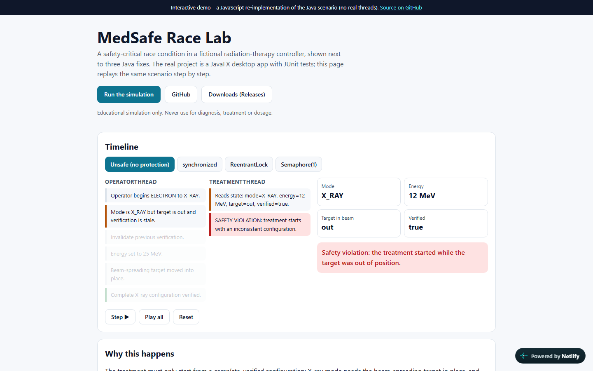
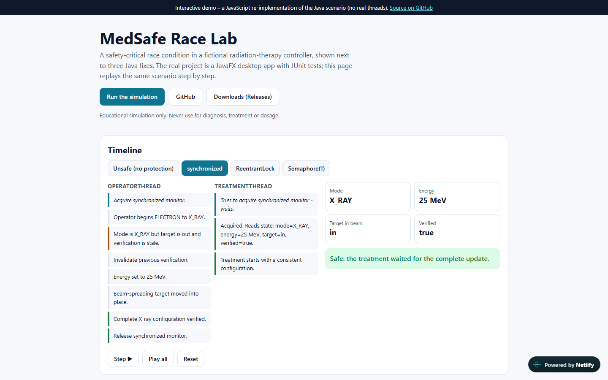
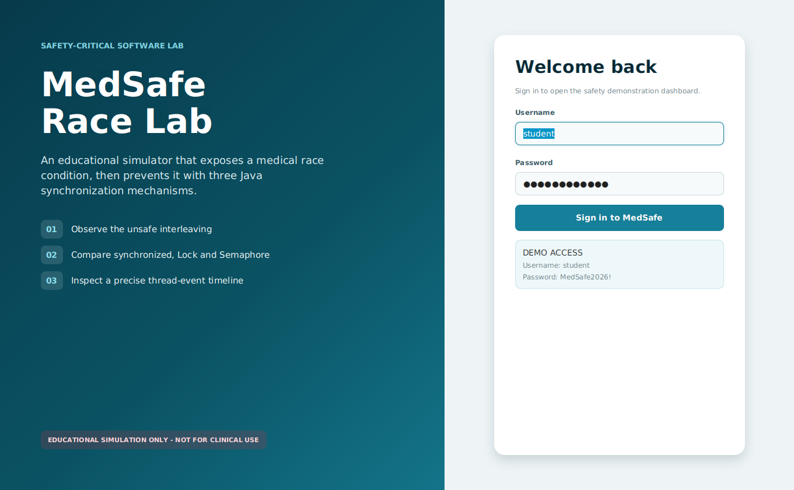
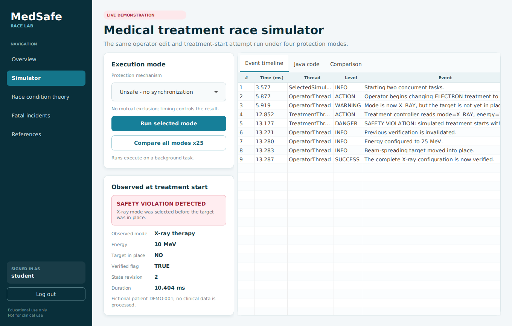
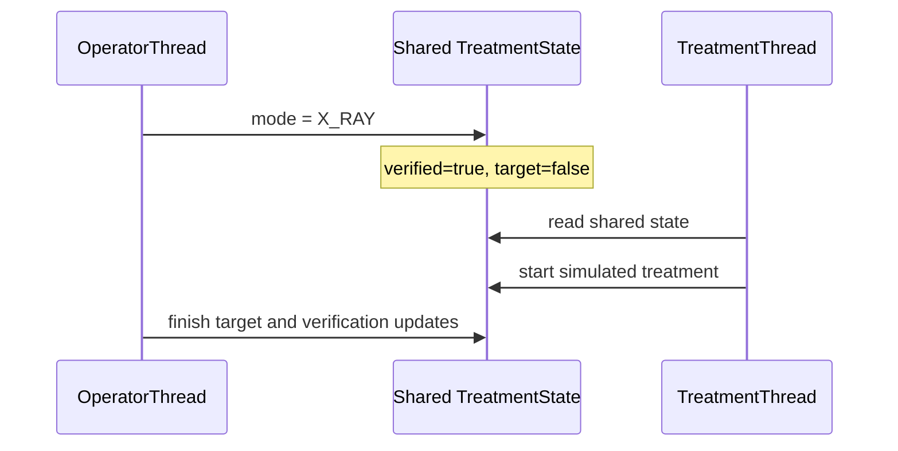

# MedSafe Race Lab

MedSafe Race Lab is an educational Java desktop application that demonstrates a safety-critical race condition in a fictional medical treatment controller. The same scenario is executed without synchronization and with three Java protection mechanisms:

1. `synchronized`
2. `ReentrantLock`
3. `Semaphore(1)`

> **Educational simulation only. This software must never be used for diagnosis, treatment, dosage calculation, or any other clinical purpose.**


### [▶ Live Demo](https://medsafe-race-lab.netlify.app)

The live demo is a JavaScript re-implementation of the race timeline (unsafe versus `synchronized`, `ReentrantLock` and `Semaphore(1)`) that you can step through in the browser. The real project is the JavaFX desktop application in this repository.

| | |
|---|---|
|  |  |
|  |  |

## What the application includes

- A login screen with PBKDF2 password verification.
- A precise definition of a race condition.
- A controlled, repeatable unsafe interleaving.
- A thread-by-thread event timeline.
- Side-by-side Java code samples.
- Repeated comparison runs for all four modes.
- A documented software-fatality research section.
- JUnit tests for the unsafe case, all safe cases, and authentication.

## Demo login

- Username: `student`
- Password: `MedSafe2026!`

The account is local and intended only to structure the demonstration. No patient or personal data is stored.

## Requirements

- JDK 17 or newer
- Apache Maven 3.9 or newer
- VS Code with the **Extension Pack for Java** (recommended)

No SQL database is required. JavaFX dependencies are downloaded automatically by Maven.

## Run in VS Code

1. Open the `MedSafe-Race-Lab` folder in VS Code.
2. Wait for the Java project import to complete.
3. Open a terminal in the project folder.
4. Run the tests:

   ```bash
   mvn clean test
   ```

5. Start the application:

   ```bash
   mvn javafx:run
   ```

## The demonstrated race

The fictional treatment begins in a verified, safe electron configuration. The operator changes it to X-ray mode in several field updates. In unsafe mode, the treatment thread reads the configuration after `mode = X_RAY` but before the target, energy, and verification are updated.



The unsafe treatment snapshot violates the project invariant:

- X-ray mode requires the beam-spreading target to be in place.
- Electron mode requires the X-ray target to be outside the beam path.
- Treatment may start only after the complete configuration is verified.

## Why the unsafe run is repeatable

Race conditions are often difficult to reproduce during a presentation. The demonstration harness uses `CountDownLatch` only to position the two tasks at the dangerous timing boundary. It does **not** protect the shared `TreatmentState` in unsafe mode.

The corrected modes reach the same timing boundary. Their treatment thread must wait for the monitor, lock, or single semaphore permit until the operator's complete update is finished.

## Project structure

```text
src/main/java/com/medsafe/racelab/
├── MedSafeApplication.java
├── auth/
│   └── AuthService.java
├── model/
│   ├── BatchResult.java
│   ├── SimulationEvent.java
│   ├── SimulationResult.java
│   └── TreatmentSnapshot.java
├── simulation/
│   ├── UnsafeStrategy.java
│   ├── SynchronizedStrategy.java
│   ├── ReentrantLockStrategy.java
│   ├── SemaphoreStrategy.java
│   └── SimulationEngine.java
└── ui/
    ├── LoginView.java
    ├── DashboardView.java
    ├── SimulatorView.java
    ├── TheoryView.java
    ├── IncidentsView.java
    └── ReferencesView.java
```

## Expected test result

| Mode | Controlled runs | Expected violations |
|---|---:|---:|
| Unsafe | 25 | 25 |
| `synchronized` | 25 | 0 |
| `ReentrantLock` | 25 | 0 |
| `Semaphore(1)` | 25 | 0 |

## Important implementation details

- `synchronized` uses the same monitor for the complete update and treatment check.
- `ReentrantLock` always calls `unlock()` in `finally`.
- `Semaphore(1)` releases a permit in `finally` only after a successful `acquire()`.
- A semaphore with two permits would not provide mutual exclusion for this scenario.
- UI work is kept off the simulation threads, and the JavaFX interface remains responsive.

## Evidence and references

- Course material: BIO-MED SW COURSE 2025, Unit 1, slides 18-25.
- FDA / IMDRF, *Software as a Medical Device (SaMD): Clinical Evaluation*, 2017.
- Nancy G. Leveson and Clark S. Turner, [An Investigation of the Therac-25 Accidents](https://escholarship.org/uc/item/5dr206s3).
- U.S. GAO, [Patriot Missile Defense: Software Problem Led to System Failure](https://www.gao.gov/products/imtec-92-26).
- U.S. House Committee, [Boeing 737 MAX Investigation](https://democrats-transportation.house.gov/committee-activity/boeing-737-max-investigation).
- NTSB, [Developmental Automated Driving System Fatal Collision Report](https://www.ntsb.gov/investigations/accidentreports/reports/har1903.pdf).

## Tests

```bash
mvn clean test
```

Result: 8 tests pass (3 in `AuthServiceTest`, 5 in `SimulationEngineTest`).

## Security notes

- Passwords are verified with PBKDF2. The demo account above is local and exists only to structure the demonstration; no personal data is stored.
- This is a safety-education project about concurrency bugs. It must never be used for clinical purposes.

## Roadmap

- Publish a runnable JAR as a GitHub Release.
- Add a CI workflow that runs `mvn test`.

## Submission

1. Complete `CREDITS.TXT` with all team members and ID numbers.
2. Run `mvn clean test` and save the successful result.
3. Upload the source project to GitHub.
4. Submit the GitHub link and the report in `docs/`.
5. Do not submit an EXE file.

